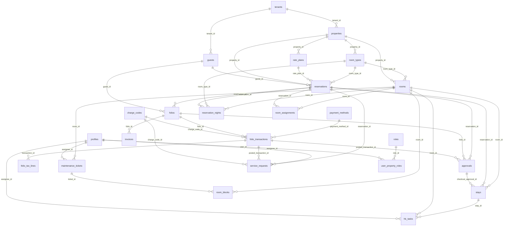

# Data model

All tables live in schema `public`, have RLS enabled, and (except the global catalogues `plans`, `permissions`, system `roles`) carry `tenant_id`. Most also carry `property_id`. Client writes are blocked by RLS; changes go through functions (see functions.md). Views are `security_invoker`, so RLS of the caller applies.

## Main relationships

Every table also references `tenants` (omitted above for readability).

## Tables

### approval_limits
Max amount per role and permission for grant level L. No row = 0.

| Column | Type | Null |
|---|---|---|
| id | uuid | no |
| role_id | uuid | no |
| permission_key | text | no |
| max_amount | numeric(20,4) | no |
| tenant_id | uuid | yes |

### approvals
Requests for discounts over limit, adjustments, reversals, refunds and unsettled check-outs.

| Column | Type | Null |
|---|---|---|
| id | uuid | no |
| tenant_id | uuid | no |
| property_id | uuid | no |
| kind | text | no |
| entity | text | no |
| folio_id | uuid | no |
| transaction_id | uuid | yes |
| payload | jsonb | no |
| amount | numeric(20,4) | no |
| currency | character(3) | no |
| reason | text | no |
| status | text | no |
| requested_by | uuid | no |
| requested_at | timestamp with time zone | no |
| decided_by | uuid | yes |
| decided_at | timestamp with time zone | yes |
| decision_reason | text | yes |
| posted_transaction_id | uuid | yes |
| idempotency_key | text | no |
| reservation_id | uuid | yes |

### audit_events
Append-only audit trail (before/after JSON) written by triggers and functions.

| Column | Type | Null |
|---|---|---|
| id | uuid | no |
| tenant_id | uuid | yes |
| actor_id | uuid | yes |
| action | text | no |
| table_name | text | yes |
| record_id | text | yes |
| before | jsonb | yes |
| after | jsonb | yes |
| reason | text | yes |
| created_at | timestamp with time zone | no |

### business_date_log
One row per rollover attempt (success or failure) with step details.

| Column | Type | Null |
|---|---|---|
| id | uuid | no |
| tenant_id | uuid | no |
| property_id | uuid | no |
| from_date | date | no |
| to_date | date | no |
| status | text | no |
| trigger | text | no |
| actor_id | uuid | yes |
| started_at | timestamp with time zone | no |
| finished_at | timestamp with time zone | no |
| details | jsonb | no |
| error | text | yes |

### charge_codes
What a folio charge is for (room, food, service, tax, other).

| Column | Type | Null |
|---|---|---|
| id | uuid | no |
| tenant_id | uuid | no |
| property_id | uuid | no |
| code | text | no |
| name | text | no |
| category | text | no |
| is_taxable | boolean | no |
| is_active | boolean | no |
| created_at | timestamp with time zone | no |

### daily_stats
One row per property per business date: rooms sold/available, revenue, movements.

| Column | Type | Null |
|---|---|---|
| id | uuid | no |
| tenant_id | uuid | no |
| property_id | uuid | no |
| business_date | date | no |
| rooms_available | integer | no |
| rooms_sold | integer | no |
| room_revenue | numeric(20,4) | no |
| total_revenue | numeric(20,4) | no |
| arrivals | integer | no |
| departures | integer | no |
| no_shows | integer | no |
| cancellations | integer | no |
| computed_at | timestamp with time zone | no |

### document_sequences
Counters for reservation, folio and invoice numbers per property.

| Column | Type | Null |
|---|---|---|
| id | uuid | no |
| tenant_id | uuid | no |
| property_id | uuid | no |
| doc_type | text | no |
| prefix | text | no |
| next_number | bigint | no |
| padding | integer | no |

### exchange_rates
Rate to base currency per currency per date.

| Column | Type | Null |
|---|---|---|
| id | uuid | no |
| tenant_id | uuid | no |
| property_id | uuid | no |
| currency | character(3) | no |
| rate_date | date | no |
| rate | numeric(20,8) | no |
| created_at | timestamp with time zone | no |
| updated_at | timestamp with time zone | no |

### folio_tax_lines
Insert-only tax lines per charge row.

| Column | Type | Null |
|---|---|---|
| id | uuid | no |
| tenant_id | uuid | no |
| property_id | uuid | no |
| transaction_id | uuid | no |
| line_no | integer | no |
| tax_code | text | no |
| tax_name | text | no |
| percent | numeric(9,4) | no |
| taxable_base | numeric(20,4) | no |
| amount | numeric(20,4) | no |
| base_amount | numeric(20,4) | no |

### folio_transactions
Insert-only ledger. Signed amounts (charges +, payments -), fx rate and base amount, idempotency key.

| Column | Type | Null |
|---|---|---|
| id | uuid | no |
| tenant_id | uuid | no |
| property_id | uuid | no |
| folio_id | uuid | no |
| kind | text | no |
| charge_code_id | uuid | yes |
| payment_method_id | uuid | yes |
| amount | numeric(20,4) | no |
| currency | character(3) | no |
| fx_rate | numeric(20,8) | no |
| base_amount | numeric(20,4) | no |
| tax_inclusive | boolean | no |
| is_deposit | boolean | no |
| description | text | yes |
| reference | text | yes |
| original_id | uuid | yes |
| idempotency_key | text | no |
| posted_by | uuid | yes |
| posted_at | timestamp with time zone | no |
| business_date | date | no |

### folios
Guest bills per reservation (one main + extras). Open or closed.

| Column | Type | Null |
|---|---|---|
| id | uuid | no |
| tenant_id | uuid | no |
| property_id | uuid | no |
| reservation_id | uuid | no |
| guest_id | uuid | yes |
| number | text | no |
| label | text | no |
| is_main | boolean | no |
| status | text | no |
| currency | character(3) | no |
| idempotency_key | text | yes |
| closed_at | timestamp with time zone | yes |
| closed_by | uuid | yes |
| created_by | uuid | yes |
| created_at | timestamp with time zone | no |

### group_bookings
Header for a group of reservations.

| Column | Type | Null |
|---|---|---|
| id | uuid | no |
| tenant_id | uuid | no |
| property_id | uuid | no |
| name | text | no |
| contact_name | text | yes |
| contact_phone | text | yes |
| notes | text | yes |
| status | text | no |
| created_by | uuid | yes |
| created_at | timestamp with time zone | no |

### guest_documents
ID documents. No client read policy; read via get_guest (masked without permission).

| Column | Type | Null |
|---|---|---|
| id | uuid | no |
| tenant_id | uuid | no |
| guest_id | uuid | no |
| doc_type | text | no |
| doc_number | text | no |
| expiry | date | yes |
| created_at | timestamp with time zone | no |

### guest_feedback
Feedback notes per guest.

| Column | Type | Null |
|---|---|---|
| id | uuid | no |
| tenant_id | uuid | no |
| guest_id | uuid | no |
| category | text | no |
| text | text | no |
| status | text | no |
| created_by | uuid | yes |
| created_at | timestamp with time zone | no |

### guests
Guest profiles, shared across a tenant's properties. Supports merge and anonymise.

| Column | Type | Null |
|---|---|---|
| id | uuid | no |
| tenant_id | uuid | no |
| first_name | text | no |
| last_name | text | no |
| phone | text | yes |
| email | text | yes |
| nationality | text | yes |
| address | text | yes |
| notes | text | yes |
| status | text | no |
| merged_into | uuid | yes |
| created_at | timestamp with time zone | no |
| updated_at | timestamp with time zone | no |
| anonymised_at | timestamp with time zone | yes |

### hk_tasks
Housekeeping tasks (turnover, stayover, deep clean, inspection) with checklist and defects.

| Column | Type | Null |
|---|---|---|
| id | uuid | no |
| tenant_id | uuid | no |
| property_id | uuid | no |
| room_id | uuid | no |
| stay_id | uuid | yes |
| type | text | no |
| status | text | no |
| priority | text | no |
| assignee_id | uuid | yes |
| checklist | jsonb | no |
| defects | jsonb | no |
| notes | text | yes |
| business_date | date | no |
| created_by | uuid | yes |
| created_at | timestamp with time zone | no |
| assigned_at | timestamp with time zone | yes |
| started_at | timestamp with time zone | yes |
| completed_at | timestamp with time zone | yes |
| completed_by | uuid | yes |
| inspected_at | timestamp with time zone | yes |
| inspected_by | uuid | yes |
| inspection_result | text | yes |
| fail_count | integer | no |
| cancelled_at | timestamp with time zone | yes |
| cancel_reason | text | yes |

### housekeeping_tasks
DEPRECATED: replaced by hk_tasks. Not used by the app.

| Column | Type | Null |
|---|---|---|
| id | uuid | no |
| tenant_id | uuid | no |
| property_id | uuid | no |
| room_id | uuid | no |
| stay_id | uuid | yes |
| kind | text | no |
| status | text | no |
| business_date | date | no |
| notes | text | yes |
| created_by | uuid | yes |
| created_at | timestamp with time zone | no |
| completed_at | timestamp with time zone | yes |

### invoices
Insert-only invoice snapshots with lines, header and tax split.

| Column | Type | Null |
|---|---|---|
| id | uuid | no |
| tenant_id | uuid | no |
| property_id | uuid | no |
| folio_id | uuid | no |
| number | text | no |
| kind | text | no |
| currency | character(3) | no |
| issued_at | timestamp with time zone | no |
| issued_by | uuid | yes |
| business_date | date | no |
| net_total | numeric(20,4) | no |
| tax_total | numeric(20,4) | no |
| gross_total | numeric(20,4) | no |
| payments_total | numeric(20,4) | no |
| balance | numeric(20,4) | no |
| tax_split | jsonb | no |
| lines | jsonb | no |
| header | jsonb | no |
| idempotency_key | text | no |

### lost_found_items
Lost and found register.

| Column | Type | Null |
|---|---|---|
| id | uuid | no |
| tenant_id | uuid | no |
| property_id | uuid | no |
| room_id | uuid | yes |
| description | text | no |
| found_at | timestamp with time zone | no |
| location | text | no |
| status | text | no |
| found_by | uuid | yes |
| claimed_by_name | text | yes |
| status_note | text | yes |
| status_changed_at | timestamp with time zone | yes |
| status_changed_by | uuid | yes |
| created_at | timestamp with time zone | no |

### maintenance_tickets
Maintenance tickets with lifecycle and resolver/closer separation.

| Column | Type | Null |
|---|---|---|
| id | uuid | no |
| tenant_id | uuid | no |
| property_id | uuid | no |
| title | text | no |
| description | text | yes |
| room_id | uuid | yes |
| location | text | yes |
| priority | text | no |
| status | text | no |
| assignee_id | uuid | yes |
| wait_reason | text | yes |
| resolution | text | yes |
| resolved_by | uuid | yes |
| resolved_at | timestamp with time zone | yes |
| closed_by | uuid | yes |
| closed_at | timestamp with time zone | yes |
| cancel_reason | text | yes |
| reopen_count | integer | no |
| last_reopen_reason | text | yes |
| business_date | date | no |
| created_by | uuid | yes |
| created_at | timestamp with time zone | no |
| updated_at | timestamp with time zone | no |

### notification_outbox
Queue of outbound email/SMS/WhatsApp messages with retry state.

| Column | Type | Null |
|---|---|---|
| id | uuid | no |
| tenant_id | uuid | no |
| property_id | uuid | yes |
| channel | text | no |
| recipient | text | no |
| subject | text | yes |
| body | text | no |
| status | text | no |
| attempts | integer | no |
| max_attempts | integer | no |
| next_attempt_at | timestamp with time zone | no |
| last_error | text | yes |
| dedupe_key | text | no |
| sent_at | timestamp with time zone | yes |
| created_at | timestamp with time zone | no |

### notifications
In-app bell notifications per user, written by DB functions.

| Column | Type | Null |
|---|---|---|
| id | uuid | no |
| tenant_id | uuid | no |
| property_id | uuid | yes |
| user_id | uuid | no |
| kind | text | no |
| title | text | no |
| body | text | yes |
| link | text | yes |
| entity_id | uuid | yes |
| read_at | timestamp with time zone | yes |
| created_at | timestamp with time zone | no |

### payment_methods
How a payment was taken (cash, card, transfer, POS, other). Recording only.

| Column | Type | Null |
|---|---|---|
| id | uuid | no |
| tenant_id | uuid | no |
| property_id | uuid | no |
| code | text | no |
| name | text | no |
| kind | text | no |
| is_active | boolean | no |
| created_at | timestamp with time zone | no |

### permissions
Catalogue of permission keys (module.action).

| Column | Type | Null |
|---|---|---|
| key | text | no |
| description | text | no |
| module | text | no |

### plans
Subscription plans and their room/property/user limits.

| Column | Type | Null |
|---|---|---|
| code | text | no |
| name | text | no |
| max_rooms | integer | yes |
| max_properties | integer | yes |
| max_users | integer | yes |
| created_at | timestamp with time zone | no |

### profiles
Staff member (1:1 with auth.users), tenant and status.

| Column | Type | Null |
|---|---|---|
| id | uuid | no |
| tenant_id | uuid | no |
| full_name | text | no |
| phone | text | yes |
| status | text | no |
| created_at | timestamp with time zone | no |

### properties
A hotel building of a tenant: currency, timezone, check-in/out times, business date, rollover time.

| Column | Type | Null |
|---|---|---|
| id | uuid | no |
| tenant_id | uuid | no |
| name | text | no |
| code | text | no |
| address | text | yes |
| city | text | yes |
| country | text | yes |
| base_currency | character(3) | no |
| timezone | text | no |
| check_in_time | time without time zone | no |
| check_out_time | time without time zone | no |
| business_date | date | no |
| created_at | timestamp with time zone | no |
| max_stay_nights | integer | no |
| tentative_hold_hours | integer | no |
| rollover_time | time without time zone | no |

### rate_plan_prices
Nightly price per rate plan and room type for a date range.

| Column | Type | Null |
|---|---|---|
| id | uuid | no |
| tenant_id | uuid | no |
| property_id | uuid | no |
| rate_plan_id | uuid | no |
| room_type_id | uuid | no |
| valid_from | date | no |
| valid_to | date | no |
| amount | numeric(20,4) | no |
| currency | character(3) | no |
| created_at | timestamp with time zone | no |

### rate_plans
Rate plans with cancellation, no-show and deposit policies (type + value).

| Column | Type | Null |
|---|---|---|
| id | uuid | no |
| tenant_id | uuid | no |
| property_id | uuid | no |
| code | text | no |
| name | text | no |
| is_corporate | boolean | no |
| cancellation_policy_type | text | no |
| cancellation_policy_value | numeric(20,4) | no |
| no_show_policy_type | text | no |
| no_show_policy_value | numeric(20,4) | no |
| deposit_policy_type | text | no |
| deposit_policy_value | numeric(20,4) | no |
| is_active | boolean | no |
| created_at | timestamp with time zone | no |

### reservation_guests
Guests attached to a reservation (one primary).

| Column | Type | Null |
|---|---|---|
| reservation_id | uuid | no |
| guest_id | uuid | no |
| tenant_id | uuid | no |
| is_primary | boolean | no |

### reservation_nights
One row per booked night; the source of availability and nightly rate.

| Column | Type | Null |
|---|---|---|
| id | uuid | no |
| tenant_id | uuid | no |
| property_id | uuid | no |
| reservation_id | uuid | no |
| room_type_id | uuid | no |
| stay_date | date | no |
| rate_amount | numeric(20,4) | no |
| room_id | uuid | yes |

### reservations
Bookings: dates, room type, rate plan, status, source, deposit, fees.

| Column | Type | Null |
|---|---|---|
| id | uuid | no |
| tenant_id | uuid | no |
| property_id | uuid | no |
| number | text | no |
| guest_id | uuid | no |
| arrival_date | date | no |
| departure_date | date | no |
| room_type_id | uuid | no |
| rate_plan_id | uuid | no |
| adults | integer | no |
| children | integer | no |
| status | text | no |
| source | text | no |
| company_name | text | yes |
| special_requests | text | yes |
| notes | text | yes |
| guarantee | text | no |
| hold_until | timestamp with time zone | yes |
| group_id | uuid | yes |
| idempotency_key | text | no |
| currency | character(3) | no |
| total_amount | numeric(20,4) | no |
| deposit_required | numeric(20,4) | no |
| rate_override | numeric(20,4) | yes |
| override_reason | text | yes |
| cancellation_fee | numeric(20,4) | yes |
| no_show_fee | numeric(20,4) | yes |
| fee_waived | boolean | no |
| status_reason | text | yes |
| cancelled_at | timestamp with time zone | yes |
| created_by | uuid | yes |
| created_at | timestamp with time zone | no |
| updated_at | timestamp with time zone | no |

### role_permissions
Permission keys per role with grant level Y (yes), L (up to limit), O (own only).

| Column | Type | Null |
|---|---|---|
| role_id | uuid | no |
| permission_key | text | no |
| grant_level | character(1) | no |
| tenant_id | uuid | yes |

### roles
System roles (tenant_id null, read-only) and tenant custom roles.

| Column | Type | Null |
|---|---|---|
| id | uuid | no |
| tenant_id | uuid | yes |
| code | text | no |
| name | text | no |
| is_system | boolean | no |
| created_at | timestamp with time zone | no |

### room_assignments
Room assigned to a reservation for a date range. Exclusion constraint prevents double assignment; released rows kept.

| Column | Type | Null |
|---|---|---|
| id | uuid | no |
| tenant_id | uuid | no |
| property_id | uuid | no |
| reservation_id | uuid | no |
| room_id | uuid | no |
| from_date | date | no |
| to_date | date | no |
| is_active | boolean | no |
| released_at | timestamp with time zone | yes |
| created_by | uuid | yes |
| created_at | timestamp with time zone | no |

### room_blocks
Out of order / out of service / hold on a room for dates; only approved blocks reduce availability.

| Column | Type | Null |
|---|---|---|
| id | uuid | no |
| tenant_id | uuid | no |
| property_id | uuid | no |
| room_id | uuid | no |
| block_type | text | no |
| from_date | date | no |
| to_date | date | no |
| reason | text | no |
| ticket_id | uuid | yes |
| status | text | no |
| requested_by | uuid | yes |
| approved_by | uuid | yes |
| approved_at | timestamp with time zone | yes |
| decision_reason | text | yes |
| released_by | uuid | yes |
| released_at | timestamp with time zone | yes |
| release_reason | text | yes |
| created_at | timestamp with time zone | no |

### room_types
Sellable room categories per property.

| Column | Type | Null |
|---|---|---|
| id | uuid | no |
| tenant_id | uuid | no |
| property_id | uuid | no |
| code | text | no |
| name | text | no |
| max_adults | integer | no |
| max_children | integer | no |
| description | text | yes |
| is_active | boolean | no |
| created_at | timestamp with time zone | no |

### rooms
Physical rooms: condition (clean/dirty/inspected/out_of_order) and occupancy kept separate.

| Column | Type | Null |
|---|---|---|
| id | uuid | no |
| tenant_id | uuid | no |
| property_id | uuid | no |
| room_number | text | no |
| room_type_id | uuid | no |
| floor | text | yes |
| condition | text | no |
| is_occupied | boolean | no |
| is_active | boolean | no |
| created_at | timestamp with time zone | no |

### service_requests
Guest service requests; chargeable ones post a folio charge once on completion.

| Column | Type | Null |
|---|---|---|
| id | uuid | no |
| tenant_id | uuid | no |
| property_id | uuid | no |
| reservation_id | uuid | no |
| category | text | no |
| description | text | no |
| chargeable | boolean | no |
| charge_amount | numeric(20,4) | yes |
| currency | character(3) | no |
| charge_code_id | uuid | yes |
| status | text | no |
| assignee_id | uuid | yes |
| posted_transaction_id | uuid | yes |
| completed_by | uuid | yes |
| completed_at | timestamp with time zone | yes |
| cancel_reason | text | yes |
| business_date | date | no |
| created_by | uuid | yes |
| created_at | timestamp with time zone | no |

### stays
Check-in record: room, registration JSON, status (in_house, checked_out, voided), check-out snapshot for undo.

| Column | Type | Null |
|---|---|---|
| id | uuid | no |
| tenant_id | uuid | no |
| property_id | uuid | no |
| reservation_id | uuid | no |
| room_id | uuid | no |
| checked_in_at | timestamp with time zone | no |
| checked_out_at | timestamp with time zone | yes |
| business_date | date | no |
| registration | jsonb | no |
| status | text | no |
| room_override_reason | text | yes |
| deposit_waive_reason | text | yes |
| void_reason | text | yes |
| created_by | uuid | yes |
| created_at | timestamp with time zone | no |
| checkout_business_date | date | yes |
| checkout_approval_id | uuid | yes |
| checkout_reason | text | yes |
| checkout_snapshot | jsonb | yes |
| checked_out_by | uuid | yes |

### tax_rates
Ordered tax lines per property; can compound on previous lines. Nigerian defaults are unverified.

| Column | Type | Null |
|---|---|---|
| id | uuid | no |
| tenant_id | uuid | no |
| property_id | uuid | no |
| code | text | no |
| name | text | no |
| percent | numeric(9,4) | no |
| sort_order | integer | no |
| compounds_on_previous | boolean | no |
| description | text | yes |
| is_active | boolean | no |
| created_at | timestamp with time zone | no |

### tenant_subscriptions
Plan and status per tenant (trial, active, past_due, expired, suspended). Drives read-only mode.

| Column | Type | Null |
|---|---|---|
| id | uuid | no |
| tenant_id | uuid | no |
| plan_code | text | no |
| status | text | no |
| trial_ends_at | timestamp with time zone | yes |
| current_period_end | timestamp with time zone | yes |
| created_at | timestamp with time zone | no |

### tenants
A hotel business (the customer account). Top of the tenant tree.

| Column | Type | Null |
|---|---|---|
| id | uuid | no |
| name | text | no |
| country | text | no |
| status | text | no |
| created_at | timestamp with time zone | no |

### user_property_roles
Which role a user has at which property.

| Column | Type | Null |
|---|---|---|
| id | uuid | no |
| tenant_id | uuid | no |
| user_id | uuid | no |
| property_id | uuid | no |
| role_id | uuid | no |
| created_at | timestamp with time zone | no |

## Views

- **v_approvals** — Approvals with requester/decider names. Columns: id, property_id, kind, folio_id, folio_number, reservation_id, transaction_id, transaction_description, amount, currency, reason, status, requested_by, requested_by_name, requested_at, decided_by, decided_by_name, decided_at, decision_reason, posted_transaction_id, guest_name, is_used.
- **v_arrivals** — Today's and upcoming arrivals with assigned room and deposit status. Columns: id, property_id, number, guest_id, guest_name, guest_phone, arrival_date, departure_date, nights, adults, children, room_type_id, room_type_code, room_type_name, rate_plan_id, status, hold_until, company_name, special_requests, total_amount, currency, deposit_required, deposit_paid, room_id, room_number, room_condition, room_is_occupied, room_is_ready, is_late.
- **v_checkouts** — Stays due out with folio balances. Columns: stay_id, reservation_id, property_id, number, status, room_number, guest_name, arrival_date, departure_date, reservation_status, checked_out_at, checkout_business_date, checkout_reason, currency, can_undo.
- **v_folio_balances** — Balance per folio (the only source of balances). Columns: folio_id, property_id, reservation_id, reservation_number, number, label, is_main, status, currency, guest_id, guest_name, arrival_date, departure_date, reservation_status, room_number, closed_at, created_at, total_debits, total_credits, balance.
- **v_folio_transactions** — Transactions with codes, poster name and reversed/transferred flags. Columns: id, folio_id, property_id, kind, charge_code_id, charge_code, charge_code_name, payment_method_id, payment_method_name, amount, currency, fx_rate, base_amount, tax_amount, total, tax_inclusive, is_deposit, description, reference, original_id, posted_by, posted_by_name, posted_at, business_date, is_reversed, is_transferred, tax_lines.
- **v_hk_board** — Housekeeping tasks with board_column for the supervisor board. Columns: id, tenant_id, property_id, room_id, stay_id, type, status, priority, assignee_id, checklist, defects, notes, business_date, created_by, created_at, assigned_at, started_at, completed_at, completed_by, inspected_at, inspected_by, inspection_result, fail_count, cancelled_at, cancel_reason, room_number, floor, room_condition, is_occupied, room_type_name, assignee_name, completed_by_name, inspected_by_name, board_column.
- **v_in_house** — Current in-house stays with room and guest. Columns: stay_id, reservation_id, property_id, number, guest_id, guest_name, guest_phone, room_id, room_number, room_type_id, room_type_code, arrival_date, departure_date, checked_in_at, checked_in_business_date, adults, children, company_name, total_amount, currency, is_departing, can_void.
- **v_kpi_daily** — daily_stats plus occupancy, ADR, RevPAR. Columns: property_id, business_date, rooms_available, rooms_sold, room_revenue, total_revenue, arrivals, departures, no_shows, cancellations, occupancy, adr, revpar.
- **v_maintenance_tickets** — Tickets with room and staff names. Columns: id, tenant_id, property_id, title, description, room_id, location, priority, status, assignee_id, wait_reason, resolution, resolved_by, resolved_at, closed_by, closed_at, cancel_reason, reopen_count, last_reopen_reason, business_date, created_by, created_at, updated_at, room_number, assignee_name, resolved_by_name, closed_by_name, created_by_name, has_active_block.
- **v_room_board** — One row per room: condition, occupied, sellable, current block. Columns: id, property_id, room_number, floor, room_type_id, room_type_code, room_type_name, condition, is_occupied, is_active, block_id, block_type, block_to_date, is_sellable, current_reservation_id, current_number, current_guest_name, current_departure_date, next_reservation_id, next_number, next_guest_name, next_arrival_date, pending_blocks.
- **v_service_requests** — Service requests with guest, room and staff names. Columns: id, tenant_id, property_id, reservation_id, category, description, chargeable, charge_amount, currency, charge_code_id, status, assignee_id, posted_transaction_id, completed_by, completed_at, cancel_reason, business_date, created_by, created_at, reservation_number, guest_name, room_number, charge_code_name, assignee_name, completed_by_name.

## Other schemas

- `app`: helper and trigger functions (no tables exposed).
- `cron`: pg_cron job `business-date-rollover` (see architecture.md).
